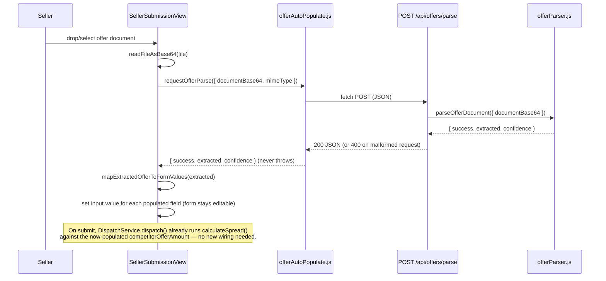
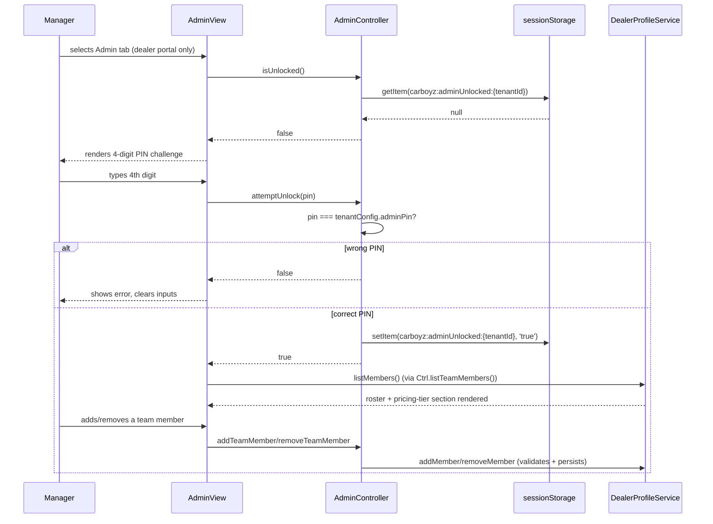
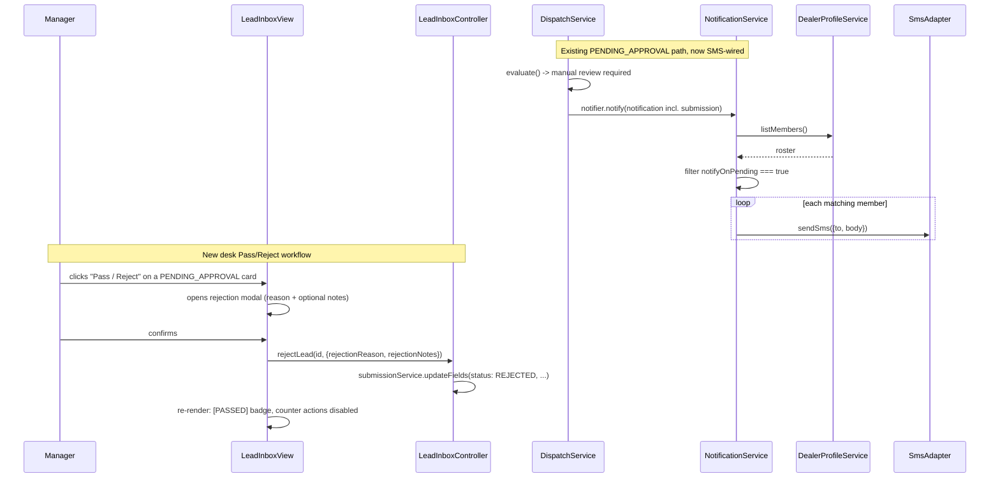
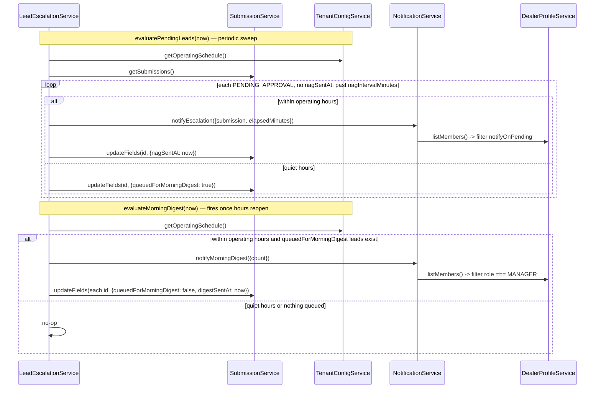
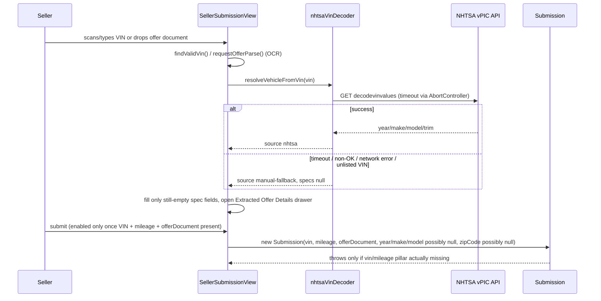

# Architect Journal — CarBoyZ

## Rebuild state - 20260902
Here is how the true architectural gaps line up and how we can proceed with UOW-CARBOYZ-24.
Key Architectural Takeaways

### 1.	Client Engine is Complete: SpreadService, SpreadConfigService, DispatchService, VIN scanner, and spatial adapters are fully functional, verified, and tested.

### 2.	Current Sync Transport: SyncAdapter handles same-origin tab syncing via BroadcastChannel and routes messages through a central Hono + WebSocket relay process (wsRelay.js).

### 3.	Primary System Gaps:
- Multi-Tenant Server Isolation: Persistent cellular backend routing per tenant (beyond in-memory WebSocket rooms).
- Mobile QR Cross-Device Handoff: Wiring qrEncoder.js to SessionStashService so a mobile phone camera scan instantly opens and syncs session state to a desktop browser.
- Offline Support: PWA Workbox service worker (sw.js) and background sync queue.
- Policy Governance: Cryptographic audit trail, policy versioning (v1.0.0), and analytics version-pinning / counterfactual "what-if" simulations.


## UOW-24 completed - 20260902
Mobile QR Cross-Device Handoff gap closed. `SessionStashService` gained a second stash
"type" (`PAIRING`, alongside the existing `SUBMISSION` approval-flow entries) with its own
lifecycle: `createPairingSession()` → `connectPairingSession()` → `PAIRING_CONNECTED`
broadcast, mirroring the existing `createPending()`/`resolveBySubmissionId()`/`RESOLVED`
pattern rather than introducing a new mechanism. `LeadInboxController.createPairingSession()`
is the desktop-side entry point (QR payload = pairing URL with `?sessionId=<pairingSessionId>`);
`SellerSubmissionController.bindPairingSession()` is the mobile-side entry point, invoked by
`SellerSubmissionView` from the scanned URL's query param on load.

No new contracts on `SyncAdapter` or the `Submission` schema — the real-time desktop-inbox
relay (`SUBMISSION_CREATED` → `SUBMISSION_SYNCED`) was already fully wired from prior UOWs and
needed no changes; this UOW only had to add the pairing handshake in front of it. Remaining
roadmap gaps unchanged: Offline Workbox PWA (Epic 3 / UOW-CARBOYZ-25) and Policy Versioning &
Audit Ledger (Epic 2 / UOW-CARBOYZ-26).

## UOW-25 completed - 20260902
Epic 3 (Offline Workbox PWA) closed. New `src/sw.js` service worker (precache app shell on
`install`, stale-while-revalidate runtime caching on `fetch`, stale-cache eviction on
`activate`) plus a new pure-logic module `src/services/OfflineCachePolicy.js` it depends on for
which URLs/requests are cacheable. No `workbox` package added — hand-rolled to preserve the
zero-dependency/ESM-first precedent; `sw.js` scope is `/` (registered via
`TenantConfigService.registerServiceWorker()`), which requires the hosting static server to
send `Service-Worker-Allowed: /` for a `src/`-nested SW file to actually claim root scope —
flagging as a known gap for whatever production static host this deploys to (`npx serve .` in
dev does not set that header, so SW registration will resolve to `null` there and the app
degrades to non-offline, same as an unsupported browser).

`SubmissionService` gained an offline-sync queue (`pendingSyncIds`, its own storage key,
`getSyncState()` PENDING_SYNC/SYNCED, `flushPendingSync(syncFn)`) rather than adding a
`PENDING_SYNC` value to `Submission.status`'s validated enum — kept `models/Submission.js`
untouched, matching this UOW's surgical file scope. `App.js` wires `window` `online`/`offline`
events to flush every tenant's queue through its `SyncAdapter` and to show a new offline banner.

Remaining roadmap gap: Policy Versioning & Audit Ledger (Epic 2 / UOW-CARBOYZ-26).

## UOW-26 completed - 20260902
Epic 2 (Policy Governance) closed. New `AuditLedgerService` is a self-contained hash-chained
ledger (own storage key per tenant, own genesis-hash/block-linking scheme) rather than being
folded into `SpreadConfigService` — keeps the crypto/chain-integrity concern testable in
isolation and reusable if another mutable config ever needs the same audit trail. Hashing is a
hand-rolled *synchronous* SHA-256, not `crypto.subtle.digest`: the existing `SpreadConfigView`
save/reset flow depends on `saveConfig()`/`resetToDefault()` staying synchronous (its error
handling is a plain `try/catch`), so an async Web Crypto call would have forced a breaking
change to that contract. Verified the implementation against Node's `crypto` module before
trusting it project-wide.

`policyVersionId` is semantic-versioned (`vMAJOR.MINOR.0`) and monotonically increasing —
`resetToDefault()` bumps the version forward rather than reverting to `v1.0.0`, so the ledger
and any pinned `Submission.policyVersionId` never appear to go "backwards" even when the tier
values themselves are reset to the built-in ladder.

`PolicySnapshot` is new: an immutable point-in-time capture of `(policyVersionId,
tiersByCompetitor, configHash)`, returned by `SpreadConfigService.getActivePolicySnapshot()`.
`SpreadService.calculateSpread()` only needed a much smaller contract change to satisfy the
"Submission Version Pinning" criterion, though — an optional `policyVersionId` parameter that
it echoes back on its result object (same pattern as the existing `matchedTier` pass-through),
which `DispatchService.dispatch()` then writes onto the `Submission` record. `PolicySnapshot`
remains available for a future consumer that needs the full tier ladder alongside the version
id (e.g. a what-if/counterfactual simulator), which is the one Epic 2 item still on the
roadmap.

No breaking changes to `SpreadConfigService.saveConfig()`'s existing single-argument call
shape — `authorId` is an additive, defaulted second-argument option (`{ authorId = 'system' }`).

Roadmap: Epic 2 (Policy Governance) and Epic 3 (Offline Support) are both now closed. Remaining
gap per the UOW-23 audit is analytics version-pinning / counterfactual "what-if" simulation
against the new `PolicySnapshot`/audit ledger — no UOW opened yet.

## UOW-27: Synthetic Submission Generator & Time-Series Historical Policy State Seeder

New pub/sub-free contract in `TestHarnessView.js`: a policy timeline is represented as an array
of `{ policyVersionId, daysAgo }` segments (oldest-to-newest by construction, `daysAgo` = days
before now the version became active), produced by `seedHistoricalPolicyTimeline()` and consumed
by `resolveActivePolicyVersion(segments, daysAgo)`. This is the same shape the UOW-23-flagged
counterfactual/what-if simulator would need to walk "what was the active policy at time T" —
no new abstraction was introduced there, this reuses `PolicySnapshot`/`AuditLedgerService`
as-is and only adds the segment-lookup convention on top.

Backdating ledger entries required temporarily reassigning `auditLedgerService.now` (a plain
instance property holding the timestamp-provider closure) around each `recordMutation` call,
restored via `finally`. No change to `AuditLedgerService`'s constructor contract — `now` was
already designed as an injectable/overridable function, just not previously mutated
post-construction.

`renderTestHarnessView` now takes an optional `spreadConfigService` so harness-seeded policy
history lands in the tenant's real audit ledger (visible to `SpreadConfigController`/analytics)
rather than a disconnected instance — additive, defaults to `null` (lazily constructs its own).

## UOW-28: Analytics Policy Version Pinning, Dynamic Filters & Responsive Layout

Closes the analytics-version-pinning gap the UOW-23 audit and UOW-27 both flagged as open.
`AnalyticsService` gains an optional `auditLedgerService` constructor dependency (`null`-safe,
mirrors the `submissionService` required-dependency pattern already in place) and a new
`getPolicyVersionPins()` contract returning `{ policyVersionId, timestamp, sequence }[]`.

Deliberate boundary decision: `AuditLedgerService` and `SpreadConfigService` were **not**
modified, even though the ledger's `recordMutation()` entries don't carry the raw
`policyVersionId` string (only hashes of the full config, which embeds it). Adding that field to
the ledger schema would be the architecturally cleaner fix, but it's outside this UOW's target
scope (`AnalyticsView.js`/`AnalyticsController.js`/`AnalyticsService.js` only). Instead,
`derivePolicyVersionPins()` reconstructs each entry's version by replaying
`SpreadConfigService.bumpPolicyVersion()` once per ledger entry in sequence, starting from
`INITIAL_POLICY_VERSION_ID` — a faithful model of `saveConfig()`/`resetToDefault()`'s real
behavior, with one known edge case: `TestHarnessView.seedHistoricalPolicyTimeline()`'s first
entry calls `applyConfig()` directly to record the *unchanged* starting version (no bump), which
this replay can't distinguish from a real bump. Flagging for whoever picks up the ledger schema
next: the durable fix is to have `AuditLedgerService.recordMutation()` accept and store the
new `policyVersionId` alongside `newConfigHash`, which would make pin derivation exact instead of
replayed. Same rationale applies to `AnalyticsService` importing `INITIAL_POLICY_VERSION_ID`/
`bumpPolicyVersion` from `SpreadConfigService.js` — a new cross-service dependency, but read-only
against already-exported pure functions, not a schema/contract change.

`AnalyticsService.filterSubmissions()`'s new `priceTier`/`approvalType` predicates and
`DATE_RANGE_PRESETS.LAST_60_DAYS`/`LAST_90_DAYS` are both purely additive to existing contracts —
no caller of the old 2-argument filter shape or the 3-preset enum breaks.

`AnalyticsView.js`'s time-series charts are hand-built SVG markup strings assigned via
`.innerHTML`, following the `qrEncoder.js`/`renderQrSvg()` precedent already established in this
codebase — the shared `h()` helper builds via `document.createElement`, which cannot produce
namespaced SVG elements, so this project's convention for any SVG content is markup-string + 
`.innerHTML`, not `h()`. Worth a template-level note if a second/third chart type gets added
later: consider a small shared SVG-string builder rather than duplicating the axis/scale math per
chart.

## UOW-CARBOYZ-29: Counterfactual "What-If" Scenario Simulation Engine

Closes the "counterfactual/what-if simulator" gap flagged as open back in the UOW-23 audit and
referenced again in UOW-27's `TestHarnessView` policy-timeline note. New `SimulationService.js`
exports `simulateCandidatePolicy(historicalSubmissions, candidateConfig)` (pure function) plus a
thin `SimulationService` class wrapping it against a `submissionService`. Contract:

```
simulateCandidatePolicy(historicalSubmissions, candidateConfig) -> {
  sampleSize: number,        // replayed (closed + FMV-derivable) submissions
  excludedCount: number,     // pool.length - sampleSize
  current:   { volume, wonCount, winRate, totalGrossMargin, avgMarginPerWonDeal, autoApprovalVolume },
  candidate: { volume, wonCount, winRate, totalGrossMargin, avgMarginPerWonDeal, autoApprovalVolume },
  delta:     { winRate, totalGrossMargin, avgMarginPerWonDeal, autoApprovalVolume },  // candidate - current
  projections: { submissionId, spreadResult, won, autoApprove, expectedMargin }[],
}
```

`candidateConfig` is validated via `SpreadConfigService.validateConfig()` (reused, not
duplicated) so it's the same `{ tenantId?, tiersByCompetitor }` shape the Admin tier editor
already produces — a candidate config is structurally just an unsaved `SpreadConfigService`
config, never written back via `saveConfig()`/`applyConfig()`.

**Architectural trade-off worth flagging for whoever touches `SpreadService.js` next:**
`calculateSpread()`'s `DealScoreStatus` is a function of `fairMarketValue` and
`competitorOfferAmount` only — `tierConfig` never influences it, only the recommended counter
offer and matched tier do. That makes a naive "was the raw status GREENLIGHT/MARGINAL" win
projection completely policy-invariant, which defeats the point of a policy simulator. Worked
around without touching `SpreadService.js` (out of scope) by calling `calculateSpread()` a second
time per submission, feeding the candidate's own `recommendedCounterOffer` back in as the
"competitor offer" with `tierConfig: []`/`counterOfferOffset: 0` — this reuses
`calculateSpread()`'s internal GREENLIGHT/MARGINAL/PASS scoring to grade the *post-counter-offer*
margin instead of the pre-offset spread, which does vary with `tierConfig`. If `SpreadService.js`
ever exposes its `scoreSpread()`/threshold constants directly, `SimulationService.projectSubmission()`
should switch to calling that instead of the double-`calculateSpread()` trick — same result, one
fewer indirection.

**Also flagged, not built:** the UOW's acceptance text mentions "margin caps" as a candidate lever
alongside tier offsets and auto-approval thresholds. No margin-cap concept exists in
`SpreadConfigService`'s tier schema (only `flatAmount`/`percent`/`strategy`/`autoApprove`).
Adding one is a `SpreadConfigService`/`SpreadService` schema change — out of this UOW's target
scope — so `SimulationService` only models what the existing tier schema already supports.
Candidate for a future UOW if margin-cap policy levers are actually wanted.

`App.js` gained a `simulation` tab (between Analytics and Test Harness in the top nav, in the
bottom nav after Analytics) and a per-tenant `SimulationService` instance alongside the existing
`analyticsService`/`spreadConfigService` — no new cross-tenant state, follows the existing
`getTenantState()` per-tenant-singleton pattern exactly.

## [UOW-CARBOYZ-30] QR Code Rendering Hotfix — 2026-09-02

`qrEncoder.js`'s `renderQrSvg(matrix, { cellSize, margin })` contract changed: `margin` is no
longer taken as a literal pixel value — it's now a *floor request* that gets clamped up to a
mandatory 4-module quiet zone (`Math.max(margin, cellSize * 4)`), and omitting it defaults to
exactly that 4-module floor. This is a behavioral (not signature) change, so every existing caller
(`LeadInboxView.js`, `TestHarnessView.js`, `appraisalPdfGenerator.js`) now renders a larger quiet
zone automatically with no call-site edits required. Any future caller that needs a *larger* quiet
zone than 4 modules can still pass a bigger `margin`; nothing can request smaller than the floor
anymore. The root `<svg>` also now always carries `shape-rendering="crispEdges"`.

## [UOW-CARBOYZ-31] QR Code Layout Refinement & Payload Density Reduction — 2026-09-02

No contract or payload schema changes. `encodeQrMatrix`'s public signature and default
(`errorCorrectionLevel: 'L'`) are unchanged — the default was already the most compact supported
level, so this UOW made that intent explicit at the one call site (`LeadInboxView.js`) rather than
changing behavior. `.pairing-card__qr` and `.pairing-card__qr svg` in `src/ui/styles.css` are now
pinned to the exact spec (280px square card, 16px margin/padding, 12px radius, SVG fills at
100%/100%) — a presentation-only change with no effect on any service or controller contract.

Noting for the roadmap: the UOW's target-scope path `public/styles.css` doesn't exist in this
repo; the actual stylesheet is `src/ui/styles.css`. Future UOW payloads referencing the stylesheet
should use that path.

## [UOW-CARBOYZ-32] Adopt @nemzilla/qr-core for Lead Inbox Pairing QR — 2026-09-02

**Dependency-boundary exception granted (CLAUDE.md §2):** `@nemzilla/qr-core` (`file:../qr-core`,
transitively pulling the third-party `qrcode` package) is now an authorized production dependency
of `carboyz`, scoped strictly to the pairing-card QR in `LeadInboxView.js`. The zero-dependency/
ESM-first precedent otherwise holds for the rest of the client codebase.

**Scope narrowed from the original ask:** the sibling package exposes only a single async
`renderQrSvg(text, options) -> Promise<string>` with no matrix-level API and no `cellSize`/`margin`
controls. Two other consumers of the existing hand-rolled `src/utils/qrEncoder.js` were identified
as incompatible with a full migration: `TestHarnessView.js` relies on matrix-level `cellSize`/
`margin` options for its live preview, and `appraisalPdfGenerator.js`'s `renderQrBlock` is a
documented synchronous, DOM-free string builder embedded into appraisal PDF SVGs — forcing it
async to match `qr-core`'s contract would break that guarantee. Decision: `qrEncoder.js` and its
other two consumers are left untouched; only `LeadInboxView.js`'s pairing-card QR now goes through
`@nemzilla/qr-core`, imported aliased (`renderQrSvg as renderPairingQrSvg`) to avoid symbol
collision with the (no-longer-imported-in-this-file) `qrEncoder.js` export of the same name.

**No payload/contract changes** to `LeadInboxController` or the pairing-session flow — only the
QR-rendering call inside `renderPairingCard`'s click handler changed, which became `async` to
`await` the new call.

## UOW-CARBOYZ-33: Mobile Viewport & CSS Responsiveness Audit — 2026-09-02

**No contract/payload changes.** Pure CSS layout fix, no architectural surface touched.

**Established convention:** `.form__row--split` is now the canonical multi-field-row primitive
(`display:grid; grid-template-columns: repeat(auto-fit, minmax(140px, 1fr))`) used by any form or
filter bar needing 2+ side-by-side fields that must wrap safely below ~640px — currently consumed
by `SellerSubmissionView`, `App.js`'s inventory form, `SpreadConfigView`, and `AnalyticsView`'s
filter bar. Future views needing a responsive multi-column field row should reuse this class rather
than hand-rolling flex layouts, to avoid reintroducing the min-width:auto overflow class of bug
fixed here.

## UOW-CARBOYZ-34: Competitor Offer Fixture Miner & Web Document Test Gallery — 2026-09-03

**No production contract changes to carboyz's own domain models/services.** This UOW extends the
sibling dev-tooling package `@nemzilla/test-core` and adds a static dev-only gallery page in
carboyz; nothing in `src/models`, `src/services`, or `src/adapters` changed.

**New `@nemzilla/test-core` surface (additive, non-breaking):**
- `SUPPORTED_COMPETITORS` grows from `['CarMax', 'Carvana', 'KBB']` to also include `'Hendrick'`
  (Hendrick Automotive Group) — same `generateMockOffer(competitor, appraisal) -> { competitor,
  text, payload }` contract, no shape change.
- New export `generateFixtures(targetDir) -> { generatedAt, documents: [{ competitor, textFile,
  metadataFile, groundTruth }] }` — the manifest shape is now the established contract between the
  miner (`bin/mine-pdfs.js`) and any consumer (carboyz's `offer-gallery.html` and
  `tests/offerGalleryFixtures.test.js`). Any future vendor added to `mock-offer.js`'s
  `OFFER_TEMPLATES` should also get a `FIXTURE_APPRAISALS` entry in `fixtures.js` to appear in the
  gallery automatically — no gallery-side code change needed since it renders off the manifest.
- `bin/mine-pdfs.js` is a new CLI entry point (`package.json` `bin.mine-pdfs`), establishing the
  precedent that `@nemzilla/test-core` can ship executables, not just an importable library.

**carboyz side:** `offer-gallery.html` is a standalone, unbundled dev page (like `vin-testbed.html`)
— not part of the tenant PWA's `index.html` app shell or nav, and not vendored through the
importmap (it fetches the manifest/text over HTTP at runtime instead of importing test-core's JS
directly). `vendor/test-core/` was refreshed via the existing `scripts/vendor-test-core.js` since
the app shell's importmap does consume `mock-offer.js`/`index.js` from that vendored copy.

**Fixtures are committed, not generated on the fly:** `public/fixtures/offers/*` is checked into
git (deterministic/seeded, so regenerating via `mine-pdfs.js` produces byte-identical VINs). This
mirrors how `vendor/test-core/` and `vendor/spatial-core/` are already committed copies of sibling
deps — no build-time codegen step was added to `npm start`'s existing `prestart` pipeline.

## UOW-CARBOYZ-35 — Node/browser boundary established in @nemzilla/test-core

`@nemzilla/test-core`'s package entry (`src/index.js`) is now a hard contract: browser-safe domain
logic only (VIN generation/validation, NHTSA decoding, vehicle presets, mock offer formatting) —
zero Node built-ins, zero `fs`/`path` access. Node-only CLI utilities (file-generating code, used
by `bin/mine-pdfs.js`) now live under a separate `src/node/` subtree and are never re-exported from
the package entry point; consumers of that Node-only code must import the file directly
(`../test-core/src/node/fixtures.js`), not through the `@nemzilla/test-core` package specifier.
No `package.json` `exports` subpath was added for `./node/fixtures.js` since the only consumer
(`bin/mine-pdfs.js`) already uses a relative import — scope was kept surgical per this UOW.

This boundary should hold for any future Node-only addition to test-core (e.g. more CLI miners):
new fs/path-dependent code belongs under `src/node/`, never re-exported from `src/index.js`.
carboyz's `scripts/vendor-test-core.js` still copies test-core's entire `src/` tree verbatim
(including `src/node/`) into `vendor/test-core/src/` — that's fine, since nothing browser-reachable
imports it, but it does mean the vendored copy is not itself proof of browser-safety; that
guarantee comes from `src/index.js`'s export list, which this UOW is what enforces.

## UOW-40 — Offer-document extraction lands on the Hono server, not the client

**New contract:** `POST /api/offers/parse` — request `{ documentBase64, mimeType }`, response
`{ success, extracted, confidence }` where `extracted` may contain any subset of
`{ vin, year, make, model, mileage, competitorOffer, competitorName }` and `confidence` mirrors
whichever keys were populated (0–1 per field). `success` is `true` for any decodable payload,
including one where nothing was found — "nothing extracted" and "request failed" are distinct;
only a missing `documentBase64` or unparsable JSON body returns `success: false` (HTTP 400).

| Decision | Selected | Alternative | Rationale |
|---|---|---|---|
| Document parsing engine | Heuristic regex over UTF-8-decoded text | A real OCR/PDF-text library | Matches the zero-dependency-per-module precedent already documented in `vinScanner.js`; this UOW's own fixtures (`public/fixtures/offers/*.txt`) are themselves plain text, so no OCR is needed to satisfy them |
| Where extraction runs | Server (`src/server/offerParser.js`) | Client, inline in `SellerSubmissionView.js` | UOW's explicit client zero-dependency boundary; also keeps the (future) real OCR swap-in a server-only change |
| `year` source | Explicit "`<year> <make> <model>`" text line only | `vinScanner.js`'s `decodeModelYear` (VIN position-10 code) | The position-10 code repeats every 30 years and measurably guessed wrong on 2 of 4 fixtures; a wrong auto-filled year is worse than no year |
| Unrecognized competitor (generic dealership offer sheet) | Document's own heading line, routed to `competitor: null` + `competitorDealerName` | Reject/omit entirely | Lets the existing "Other" + dealer-name path (already in `SellerSubmissionView.js`/`Submission` model) absorb it without a new field or enum value |

**Sequence — drop-to-populate:**


**Architectural wisdom:** The form-auto-population boundary deliberately sits at "set `.value` on
existing inputs," not "replace the form's state model." That's why acceptance criterion #4 (spread
auto-calculates on populate) needed zero new code — `DispatchService` already reads
`submission.competitorOfferAmount` from whatever's in the input at submit time, whether a seller
typed it or the parser filled it in. Any future change to how the form reads its own state should
preserve that property, or this UOW's auto-population silently stops feeding the spread calc.

## UOW-41 — One process, one port: `src/server/index.js` now serves the PWA shell too

**Decision:** `npm start` no longer boots two processes (`npx serve .` on 8080 + `node
src/server/index.js` on 8787). There is now exactly one process, one port (`PORT` env or `8080`
default), one `Hono` app: API routes first, then `@hono/node-server/serve-static` as a trailing
catch-all over the repo root. `npm run start:server` is gone — `npm start` is it.

| Decision | Selected | Alternative | Rationale |
|---|---|---|---|
| Static file serving | `@hono/node-server/serve-static` | `npx serve` as a second process | Already a sub-export of the existing `@hono/node-server` dependency — zero new packages; also removes the CORS requirement for `/api/*` since the frontend and API now share an origin |
| Route ordering | API routes registered, *then* static catch-all | Static first, API as 404 fallback | Matches the UOW's literal precedence wording; also skips a filesystem stat for every API request, since Hono's handler chain short-circuits once a non-middleware route responds |
| `staticRoot` resolution | `import.meta.url`-derived absolute repo path | `process.cwd()` | Correct regardless of which directory the process (or `node --test`) was launched from |

**Consequence for any future route:** a new API route must be registered in `createApp()` *before*
the `serveStatic` catch-all at the bottom of the function, or it will never be reached for a path
that happens to not exist on disk — it'll just 404 via the static middleware's fallthrough instead
of ever running. This mirrors the existing precedent (`/api/v1/health`, `/api/v1/tenants/:tenantId`,
`/api/offers/parse` are all above the `serveStatic` line); keep new routes above that line too.

**Now-dead assumption to retire:** `.hydrate/archive/UOW-15.md`'s note that "this app has no
server/backend component" and `docs/RECONSTRUCTED_STATE.md`'s description of `src/server/index.js`
as "independent of the static PWA bundle" were both true when written (UOW-15, UOW-23) but are
superseded as of UOW-40 (the `/api/offers/parse` backend) and this UOW (the merged runtime). Left
those historical documents un-edited, since they're point-in-time snapshots/journals, not living
docs — but anyone reasoning from them about "no backend" or "two processes" should check `npm
start`'s current behavior instead.

## UOW-42 — `POST /api/offers/parse` accepts images; `extracted` gained an `isEstimate` flag

**Decision:** `parseOfferDocument`/`POST /api/offers/parse` now branch on `mimeType`. A
`documentBase64` paired with `mimeType` in `{image/jpeg, image/png, image/heic}` is treated as a
photo/screenshot, not a text/PDF document, and resolved through a **deterministic fixture
adapter** (SHA-256 of the raw bytes → lookup in a hardcoded `IMAGE_FIXTURES` table in
`src/server/offerParser.js`), not an OCR/vision call. An unrecognized image falls through to the
same regex-over-decoded-text extraction the text path already used (now factored out as
`extractFromText()`, shared by both paths).

| Decision | Selected | Alternative | Rationale |
|---|---|---|---|
| Image understanding | Deterministic content-hash → fixture table | Real OCR/vision API integration | No vendor/API was specified by this UOW; a real network call would make parsing behavior non-deterministic and network-dependent in tests/CI, violating the existing zero-crash/graceful-degradation contract documented in `offerParser.js`. A `OFFER_VISION_API_KEY`-style env seam is noted in-code for a future UOW to wire a real integration behind, without that future change needing to touch the fixture path. |
| Fixture keying | SHA-256 of raw image bytes | Filename/path convention | Content-addressed — survives a fixture file being renamed or copied, and can't silently match the wrong file. |
| Unrecognized-image behavior | Fall through to the existing text-regex extractor on the image's own bytes | Return empty immediately | Costs nothing extra, reuses existing code, and still catches the edge case of a mislabeled-but-legible payload — consistent with the file's existing "degrade, don't fail" precedent. |

**New payload field:** `extracted.isEstimate: true` marks a recognized competitor "Estimate"
screen — these are a *distinct business case* from a normal offer sheet: they deliberately omit
the VIN (to avoid lead spam from a non-committal quote), so `extracted.vin` is never present
alongside `isEstimate: true`. `mapExtractedOfferToFormValues()` (`src/ui/offerAutoPopulate.js`)
passes this through as `values.isEstimate` (default `false`). Any future caller of
`parseOfferDocument`/`mapExtractedOfferToFormValues` that branches on the presence of `extracted`
fields should treat `isEstimate: true` + missing `vin` as an expected, valid partial result, not
an extraction failure.

**No contract change to the submission/spread pipeline:** `Submission`'s constructor already
requires a `vin` (throws without one) and the Sell form's VIN `<input>` already carries
`required`, so a VIN-less estimate can populate the form but can never reach
`controller.submitSubmission()` — the wholesale-tier computation in `SpreadService` was already
correctly VIN-gated for unrelated, pre-existing reasons, not newly added by this UOW.

## UOW-43 — `Submission` schema gains offer provenance + dealer-reporting analytics fields

**Decision:** `Submission` (`src/models/Submission.js`) gained four new fields:
`offerSourceType` (`'ESTIMATE' | 'FIRM_OFFER'`, defaults to `'FIRM_OFFER'`), `isAutoApproved`
(boolean|null), `priceTierBucket` (string|null), `projectedMargin` (number|null). All four are
computed and persisted by `DispatchService.dispatch()` (and, for the human-approval path,
`LeadInboxController.approveAndSend()`), never by the client at intake time except
`offerSourceType` itself, which `SellerSubmissionView.js` sets before `submitSubmission()`.

**Where `offerSourceType` is decided — and a correction worth flagging for any future consumer:**
it reflects the *competitor offer's own provenance* (parsed from a VIN-less UOW-42 "Estimate"
screenshot vs. a firm written offer or manual entry), not whether the submission's `vin` field is
populated. `vin` is `required` on the Sell form regardless, so every submitted lead has one either
way — `offerSourceType` is the only signal that distinguishes "we have a VIN AND a firm competitor
number" from "we have a VIN but the competitor number is just their online estimate." Any future
code reading `submission.vin` presence as a proxy for "firm offer" would be wrong; always read
`offerSourceType` directly.

| Decision | Selected | Alternative | Rationale |
|---|---|---|---|
| `projectedMargin` vs. reusing `expectedMargin` | New field, same formula, written everywhere `expectedMargin` is written | Rename/repurpose `expectedMargin` | UOW-43's Lead Record Schema names `projectedMargin` explicitly; `expectedMargin` already has three live `AnalyticsService.js` consumers (`computeMarginTotals`, `computeCompetitorMatrix`, `computeTimeSeries`) plus its own tests. Renaming was out of this UOW's surgical scope — accepted the literal duplication (documented in both `Submission.js` and `DispatchService.js`) over a broader refactor. |
| `priceTierBucket` boundaries | New, separate fixed scale in `DispatchService.js` (`<10k`/`10k-20k`/`20k-30k`/`30k+`) | Reuse `AnalyticsService.js`'s existing `PRICE_TIERS` (`$0–$15k`/`$15k–$30k`/`$30k+`) | UOW-43 specified different literal boundaries for a different purpose (a bucket persisted once per lead for dealer reporting) than `AnalyticsService`'s tiers (a live analytics-dashboard filter, independently configurable in spirit even though currently a fixed array). Two distinct, independently-evolvable concepts that happen to both be called "price tier" — a future consolidation would be a deliberate architectural call, not something to default into silently. |
| `isAutoApproved` semantics | `true` only on `DispatchService`'s auto-dispatch branch; `false` everywhere else (manual/pending dispatch, and `LeadInboxController.approveAndSend()`) | Derive from `spreadResult.matchedTier?.autoApprove` (the policy-tier flag) | The UOW's own description — "whether the counter was automatically calculated **vs rep-adjusted**" — is about whether a human touched the *final* number before it went out, which is exactly what `approvalType` (`AUTO_DISPATCH` vs `HUMAN_APPROVED`) already encodes; the tier's `autoApprove` flag only means "eligible for auto-dispatch," which can still land on the manual path if the deal doesn't also score GREENLIGHT (see `DispatchService.evaluate()`). `isAutoApproved` is written as a mirror of `approvalType === 'AUTO_DISPATCH'`, explicitly at every write site rather than derived, so the invariant is visible in each call rather than implicit. |

**Lead Inbox / appraisal sheet consumers:** `LeadInboxController.buildLeadViewModels()` now
passes `offerSourceType` through to the view model; `LeadInboxView.js` exports a pure
`offerSourceBadge(offerSourceType)` lookup (`ESTIMATE` → amber, `FIRM_OFFER` → green) rendered as
a third badge on each lead card. `appraisalPdfGenerator.js`'s `buildAppraisalPayload()` picks the
SVG appraisal sheet's subtitle text from `submission.offerSourceType` (conditional-on-inspection
wording for `ESTIMATE`, guaranteed wording for `FIRM_OFFER`/unset). Any new lead-card badge or
generated-document consumer added later should read `offerSourceType` the same way rather than
re-deriving provenance from other fields (e.g. `competitorName`, `vin` presence) that don't
actually encode it.

## UOW-45 — New fixture ground-truth manifest convention: `tests/fixtures/manifest.json`

**Decision:** any future fixture added to `public/fixtures/offers/` (a new screenshot, a PDF once
that format is supported, a trade slip) must get a matching entry in `tests/fixtures/manifest.json`
— `tests/integration/fixtureHarness.test.js` has a coverage test that fails if the manifest's
`filename`s don't exactly match every non-`.json` file in that directory, so this isn't optional
housekeeping, it's enforced. This is a **separate, new artifact** from the pre-existing
`public/fixtures/offers/manifest.json` (the UOW-CARBOYZ-34 fixture-miner's own index/
metadata-companion format, still read only by `tests/offerGalleryFixtures.test.js`) — the two were
kept intentionally un-merged rather than guessing the Lead Architect wants one unified fixture
format; a future consolidation is a deliberate call, not a default.

**Manifest entry shape:** `{ filename, mimeType, competitor, offerSourceType, expectedAmount,
expectedExtraction, vehicle }`. `expectedExtraction` is a literal snapshot of what
`offerParser.js` currently returns for that file (not every field offerParser.js *could*
theoretically find — several fixtures only partially extract, e.g. no vehicle-line text means no
year/make/model) and is the only part of this manifest meant to be regenerated —
`npm run fixtures:update` (`scripts/update-fixture-manifest.js`) re-runs the real parser against
every fixture's bytes and overwrites only that block. `vehicle` is the full real-world ground
truth (used to complete a `Submission` payload when extraction itself is partial) and, like
`competitor`/`offerSourceType`/`expectedAmount`, is hand-maintained business fact, never touched by
the re-baseline script. Spread math and the appraisal SVG banner are never snapshotted anywhere —
`fixtureHarness.test.js` asserts those dynamically against whatever `SpreadConfigService` is
currently configured, by design (so the harness itself catches an unintended pricing-formula
regression, rather than blessing whatever the formula currently produces).

## [UOW-47] Two-Tier Counter Offers: No-VIN Conditional vs. Verified-VIN Guaranteed — 2026-10-13

**New abstraction:** `offerSourceType` (`Submission.OFFER_SOURCE_TYPES`) was already a two-value
enum (`ESTIMATE` / `FIRM_OFFER`). This UOW adds a second, orthogonal dimension — VIN presence —
that only matters when `offerSourceType === 'ESTIMATE'`, producing an effective three-state
classification (no-VIN estimate / verified estimate / firm offer) without adding a new persisted
field or enum value. The third state is derived everywhere it's consumed (`SpreadService`,
`LeadInboxView`'s badge) from `offerSourceType === 'ESTIMATE' && !vin`, rather than stored — kept
`Submission`'s schema unchanged and avoided a migration-shaped change for a UI/pricing concern.

**Pricing contract change:** `SpreadService.calculateSpread()` gained two optional params,
`offerSourceType` and `vin`. When both indicate a no-VIN estimate, the per-competitor/price
`tierConfig` ladder (`SpreadConfigService`) is bypassed entirely in favor of a new flat
`NO_VIN_ESTIMATE_BEAT_BUMP` (275, `SpreadConfigService.js`) and `matchedTier` is reported as
`null`. Every other caller shape (verified ESTIMATE, FIRM_OFFER, or omitting the new params) is
unaffected — this was a deliberate, PO-directed constraint so UOW-44's golden pipeline test
(Carvana/Jeep estimate fixture, submitted *with* a seed VIN) keeps its exact pre-UOW-47 numbers
and `AUTO_COUNTER_SENT` outcome. Only a genuinely no-VIN submission takes the new path.

**Trade-off accepted:** because `matchedTier` is `null` for a no-VIN estimate, `DispatchService`'s
`autoApprove = matchedTier?.autoApprove ?? false` collapses to `false` unconditionally — a no-VIN
estimate can never auto-dispatch, no matter the competitor-offer price bracket. This wasn't an
independently specified rule; it falls out of bypassing the only source of `autoApprove: true`.
Accepted as correct business behavior (an unverified estimate shouldn't auto-fire a guaranteed
counter), but flagged here since it's an emergent consequence, not a rule written down anywhere
else — a future change to tier-based auto-approval should re-examine whether no-VIN estimates
need their own explicit (likely still `false`) auto-approve policy instead of inheriting it
implicitly from `matchedTier` being `null`.

**Breaking signature change (intentional, non-persisted):** `LeadInboxView.offerSourceBadge`
changed from `(offerSourceType)` to `(offerSourceType, vin)`. A 1-arg call with
`offerSourceType === 'ESTIMATE'` now returns the no-VIN badge instead of the verified one — this
is a pure-function UI helper with no stored callers outside this repo, so the signature was
changed in place rather than versioned or dual-pathed.

**Sequence — no-VIN estimate submit -> preliminary counter -> VIN upgrade:**
```mermaid
sequenceDiagram
    participant Seller
    participant View as SellerSubmissionView
    participant Submission
    participant Dispatch as DispatchService
    participant Spread as SpreadService

    Seller->>View: uploads Carvana "Estimate" screenshot (no VIN)
    View->>View: offerSourceType = 'ESTIMATE'; vinInput.required = false
    Seller->>View: submits with VIN blank ("Unlock Maximum Offer" CTA shown, not required)
    View->>Submission: new Submission({ offerSourceType: 'ESTIMATE', vin: undefined })
    Submission-->>View: vin stored as null (no throw)
    View->>Dispatch: dispatch(submission)
    Dispatch->>Spread: calculateSpread({ offerSourceType: 'ESTIMATE', vin: null, tierConfig })
    Spread-->>Dispatch: { recommendedCounterOffer: offer + 275, matchedTier: null }
    Dispatch-->>View: PENDING_APPROVAL (matchedTier null -> autoApprove false)
    Note over Seller,Dispatch: Seller later adds VIN (same or new submission) ->
    Note over Seller,Dispatch: offerSourceType stays 'ESTIMATE', vin now present ->
    Note over Seller,Dispatch: calculateSpread takes the normal tierConfig path, unchanged
```

## UOW-48 — Role Route Separation, Admin PIN Lockout, and Dealer Profile Roster UI — 2026-10-15

**Technology Decisions Log**

| Decision | Selected | Alternative | Rationale |
|---|---|---|---|
| View routing mechanism | `?view=seller\|dealer` query param, resolved client-side, **plus** a server-side `/dealer` SPA-fallback route | Query-param only, no server change | UOW spec named both `/` and `/dealer` as valid routes. Query-param-only would have left `/dealer` 404ing (no history-API fallback in Hono's `serveStatic`). Product Owner was asked explicitly (this touches `src/server/index.js`, outside the UOW's named files) and chose the server-fallback option. |
| Admin unlock persistence | `window.sessionStorage`, keyed `carboyz:adminUnlocked:{tenantId}` | `localStorage` (persists across browser restarts) or in-memory only (lost on any re-render) | Matches the spec's "unlocked for this browser session" wording literally — survives a reload within the tab/session, clears on tab close, unlike `localStorage`. |
| Admin view composition | New `AdminController`/`AdminView` wrap the existing `SpreadConfigController`/`renderSpreadConfigView` rather than merging the roster into `SpreadConfigView.js` | Extend `SpreadConfigView.js` in place | `SpreadConfigService`/`SpreadConfigController` are a distinct, already-tested domain (pricing tiers) from the new roster domain; wrapping keeps both independently testable and avoids widening `SpreadConfigView.js`'s already-single responsibility. The UOW's own file names (`AdminView.js`/`AdminController.js`) also pointed at new files — no such files existed pre-UOW-48 despite the "Admin" tab already existing (it rendered `SpreadConfigView` directly). |
| Team roster storage | New `DealerProfileService` (`carboyz:dealerProfile:{tenantId}`) | Extend `TenantConfigService` | `TenantConfigService` is theming/manifest/service-worker plumbing with no `storage`-backed persistence today; a new service matching the `SpreadConfigService`/`SubmissionService` read-validate-write-to-storage pattern was the better fit and the spec explicitly offered this as an option. |

**Sequence — dealer portal Admin tab: PIN gate -> unlock -> roster CRUD:**


**Architectural Wisdom**
- Seller-view and dealer-view are resolved **once per page load** (`mountApp`), not reactively —
  matching the existing tenant-resolution precedent (`?brand=` is also read once at mount, not
  re-read on every `render()`). Switching views is a real navigation (`<a href="?view=seller">`),
  not an in-app route change; there is no client-side router in this codebase and adding one was
  out of scope for this UOW.
- The Admin PIN is a *lightweight* deterrent (plain 4-digit match against a tenant-config value
  shipped to the client, no hashing/rate-limiting), appropriate for its stated purpose ("protect
  behind a Manager PIN" for walk-up-device UX) but **not a security boundary** — anyone with
  browser devtools can read `tenantConfig.adminPin` or flip `sessionStorage`. If Admin ever needs
  to gate something sensitive (e.g. real PII, not just pricing-tier config and a roster of names/
  phone numbers), this should move server-side.
- `DealerProfileService` and `SpreadConfigService` are now both reachable from inside the Admin
  view but remain fully independent services/storage keys — there is no shared "Admin domain"
  abstraction, by design, to avoid coupling pricing policy to roster management prematurely.

## UOW-49 completed - 20261015
Desk Pass/Reject workflow, hardened title/theft appraisal disclaimers, a pluggable SMS
notification dispatch hook, and a Hono `basicAuth` gate on the `/dealer` portal.

**Technology Decisions Log**

| Decision | Selected | Alternative | Rationale |
|---|---|---|---|
| Dealer-portal auth | Hono `basicAuth` middleware on `/dealer` + `/dealer/*` | Session-cookie login flow | UOW scope is a lightweight walk-up-device gate, same tier as UOW-48's Admin PIN — not a real auth system. `hono/basic-auth` ships with the already-installed `hono` dep, zero new packages. |
| SMS transport | `TwilioSmsAdapter` calling Twilio's REST API directly via `fetch` + HTTP Basic Auth | `twilio` npm SDK | Keeps the zero-dependency/ESM-first precedent; Twilio's REST API needs no SDK for a single `POST /Messages.json` call. |
| Notifier wiring location | `NotificationService` constructed in `App.js` (client) with `ConsoleSmsAdapter` only | A new server route that owns real Twilio dispatch | `DispatchService` (the thing that decides `PENDING_APPROVAL`) only runs client-side today — no server endpoint exists for it. Shipping real Twilio credentials into the browser bundle would be a secrets-exposure vulnerability, so the Twilio-capable path is exercised only in Node (tests / a future trusted backend), not wired live. |
| `NotificationService` contract | `notify(notification)`, matching `DispatchService`'s existing `notifier` DI slot | A new `onPendingApproval` hook on `DispatchService` | No new coupling needed — `buildApprovalNotification()` already had a single call site; adding `submission`/`recommendedCounterOffer` to its return value was additive and let the existing `notifier.notify()` contract carry everything `NotificationService` needs. |

**Workflow / Sequence Diagram**



**Architectural Wisdom**
- The literal UOW spec implied a `src/server/services/NotificationService.js` vs
  `src/client/services/DispatchService.js` split that doesn't exist in this repo (everything is
  flat under `src/services`). Rather than inventing that split or a new unrequested server route,
  `NotificationService` lives beside `DispatchService` in `src/services/`, and the Twilio-sending
  path is a tested capability of the module that is deliberately **not** exercised from the
  browser bundle — only `ConsoleSmsAdapter` is. If real SMS dispatch is ever wanted from production,
  it needs a trusted backend (a new Hono route) to hold the Twilio credentials and call
  `NotificationService` server-side; this UOW does not build that route.
- `buildApprovalNotification()`'s return value gained `submission`/`recommendedCounterOffer`
  fields. This was additive on purpose — the existing `dispatchService.test.js` assertions only
  check specific fields (`target`, `submissionId`, `title`/`body` via `match`), never a full
  `deepEqual`, so extending the notification shape to carry what a richer notifier needs couldn't
  silently break an existing contract.
- `REJECTED` is a new **terminal** `Submission.status` requiring a `rejectionReason`, enforced in
  the model constructor (not just at the controller layer) — the same "validate at the model, not
  just the call site" precedent as every other `Submission` field. The Lead Inbox's "Active" vs
  "Passed / Closed" filter is scoped to `REJECTED` only, not the pre-existing `DECLINED` status, to
  avoid silently reinterpreting a status that predates this UOW.
- `appraisalPdfGenerator.js`'s disclaimer renderer previously assumed every disclaimer string fits
  one fixed-position `<text>` line with no wrapping. Adding two longer legal disclaimers exposed
  that this assumption would have overflowed the document's printable width — fixed with a small
  greedy word-wrapper and a footer position that floats below the wrapped content, rather than
  working around it by keeping the new disclaimers artificially short.

## UOW-50 completed - 20261015
Desk unreviewed-lead escalation SMS nags, a per-tenant operating-hours/quiet-hours gate, and a
morning-digest rollup for anything that arrived overnight.

**Technology Decisions Log**

| Decision | Selected | Alternative | Rationale |
|---|---|---|---|
| Quiet-hours evaluation | Pure `isWithinOperatingHours(date, schedule)` resolving the hour via `Intl.DateTimeFormat` in `schedule.timeZone` | A date library (`luxon`/`date-fns-tz`) dependency | Keeps the zero-dependency/ESM-first precedent; `Intl` is a platform API, no package needed for a single hour-in-zone lookup. |
| Morning-digest "transition" detection | Data-driven: dispatch once per open period, driven by `queuedForMorningDigest` flags, which clear on dispatch | An explicit closed→open state machine tracking the last-evaluated hour | Nothing in this app persists a server-side clock tick between evaluations; clearing the flag on dispatch makes a second same-period sweep a natural no-op without inventing extra state to track. |
| `TenantConfigService` schedule access | Service now retains `this.activeTenantConfig` from the last `applyTenant()` call, exposed via `getOperatingSchedule()` | Passing the `tenantConfig` object directly into `LeadEscalationService` instead of through the service | UOW's own Task 2 contract names `tenantConfigService` as the constructor dependency, not a raw config object; extending the service to retain what it's already given keeps that contract honest without a parallel data path. |
| Escalation vs. digest audience | Escalation SMS reuses the `notifyOnPending` roster gate; morning digest filters to `role === MANAGER` | Both messages going to the same roster | The digest template literally addresses "CarBoyZ desk" managers, not reps — treated as a deliberate, template-implied audience split rather than one undifferentiated broadcast list. |

**Workflow / Sequence Diagram**



**Architectural Wisdom**
- The UOW spec again named `src/client/...` paths that don't exist here; mapped onto the real
  flat `src/config`/`src/services`/`src/ui` tree, same precedent as UOW-49.
- `Submission`'s constructor is a strict named-parameter whitelist — any field not declared there
  is silently dropped on every `updateFields()` patch. The UOW's field list only named
  `TenantConfig.js`, but `nagSentAt`/`queuedForMorningDigest`/`digestSentAt` had to be added to
  `Submission.js` too, or Tasks 2/3's own patches would have been no-ops. Treated as a required
  data-contract fix, not scope creep — the alternative was a feature that silently never persisted.
- `evaluateMorningDigest()` deliberately doesn't try to detect a literal closed→open clock edge.
  It dispatches whenever it's called during operating hours and something is queued, then clears
  the queue flag so a later same-period call is inert. This is simpler and just as correct as a
  state machine as long as something calls it periodically — but nothing does yet (see below).
- **Not wired into `App.js`:** no task in this UOW asked for a polling loop
  (`setInterval`/equivalent) to actually invoke `evaluatePendingLeads`/`evaluateMorningDigest` on a
  timer. The service and its tests are real and correct, but the feature is inert in the running
  app until something schedules those calls — flagged to the Product Owner as the natural
  UOW-HOTFIX or next-UOW follow-up.

## [UOW-51] Streamlined 3-Pillar Customer Intake (VIN, Mileage, Offer Doc) — 2026-10-15

**Technology Decisions Log**

| Decision | Selected | Alternative | Rationale |
|---|---|---|---|
| Production VIN decode | New `src/services/nhtsaVinDecoder.js` — zero-dependency direct fetch to NHTSA's public vPIC endpoint, `AbortController` timeout | Reuse `src/components/dev/TestBedDrawer.js`'s `resolveVehicleFromVin` (imports `@nemzilla/test-core`) | `@nemzilla/test-core` is explicitly a dev-only test-bed toolkit; importing it into the customer-facing bundle breaks the client zero-dependency boundary (Section 2). PO authorized the extraction as a one-time exception, decoupled from the dev component. |
| UOW-47 no-VIN "ESTIMATE" exception | Kept at the model/service layer exactly as-is; only the live form's VIN input is now unconditionally required | Make `vin` unconditionally required on `Submission` itself | The exception is load-bearing for `DispatchService`/`SpreadService`/`SpreadConfigService.NO_VIN_ESTIMATE_BEAT_BUMP`/Lead Inbox badge/appraisal PDF and their tests. Removing it at the model layer would have deleted a shipped feature well outside this UOW's "update zipCode fixtures" scope. |
| `offerDocument` pillar enforcement | UI-only (`SellerSubmissionView.js` submit-button gating) | Hard `throw` in `Submission.js` constructor | `TestHarnessView.js`'s synthetic-data generator (the completed Analytics/Simulation epic's seeding pipeline) always builds submissions with `offerDocument: null`; a model-level throw would break that pipeline and its tests. |

**Workflow / Sequence Diagram — VIN entry to auto-populated specs**



**Architectural Wisdom**
- Same path-mapping precedent as UOW-49/UOW-50: the UOW named `src/client/...` paths that don't
  exist; mapped onto the real flat tree.
- This UOW is the first case where the Lead Architect's own authorization text, read literally,
  would have broken already-shipped, tested capability (UOW-47's no-VIN estimate flow, and the
  synthetic-data seeding pipeline) if applied at the domain-model layer rather than the UI layer.
  Resolved by pushing the "3 mandatory pillars" business rule to the customer-facing form's
  submit-gating only, leaving `Submission.js`/`SellerSubmissionController.js` as permissive as
  before except for the specific fields this UOW asked to relax (`zipCode`/`year`/`make`/`model`)
  or tighten (`mileage`'s positive-number check). Worth a standing note for future UOWs: "the 3
  mandatory pillars are strictly X, Y, Z" type directives should be read as a form-level UX rule
  unless the UOW explicitly calls out every downstream consumer of the relaxed/tightened model
  field by name.
- `nhtsaVinDecoder.js` deliberately does not import anything from `src/components/dev/` or
  `@nemzilla/test-core` — it duplicates the small NHTSA response-normalization shape rather than
  sharing code with the dev Test Bed, keeping the production bundle's dependency graph clean at
  the cost of a small amount of duplication between the two.
